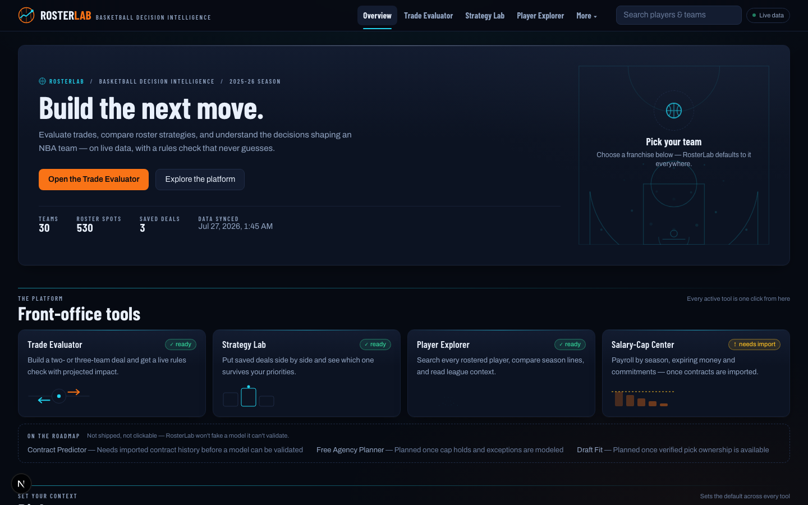
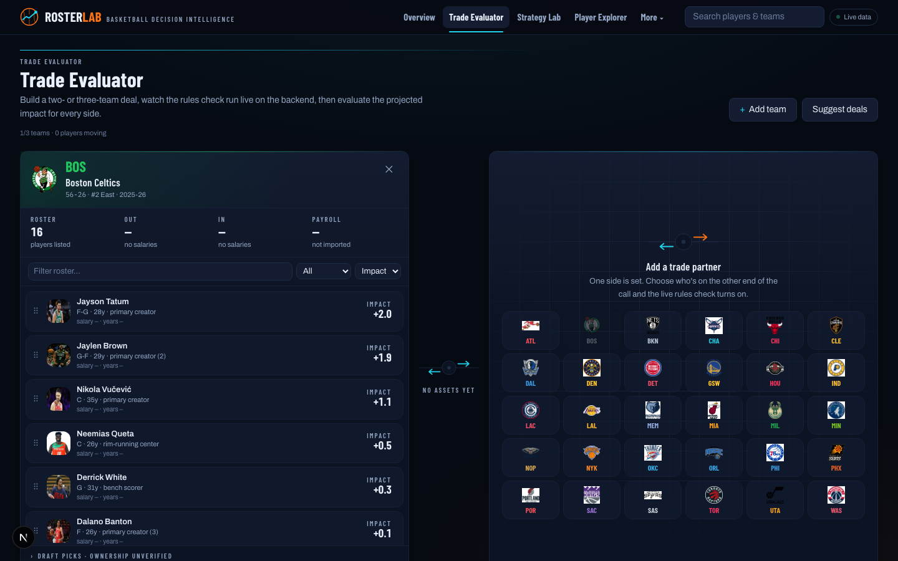
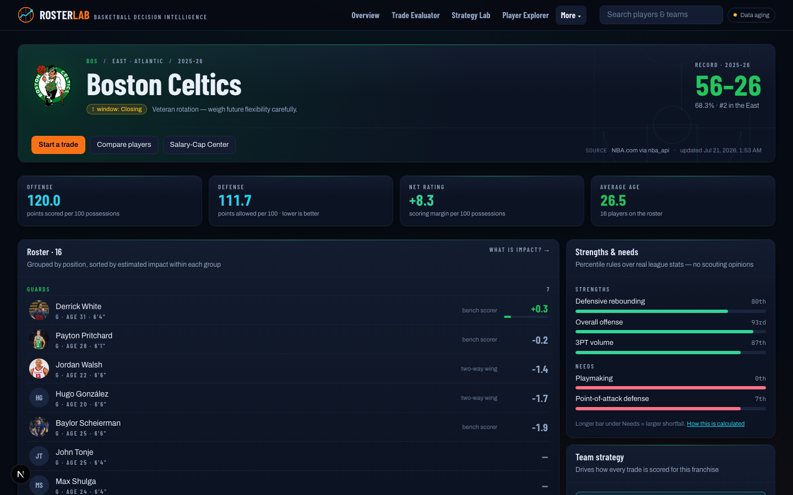
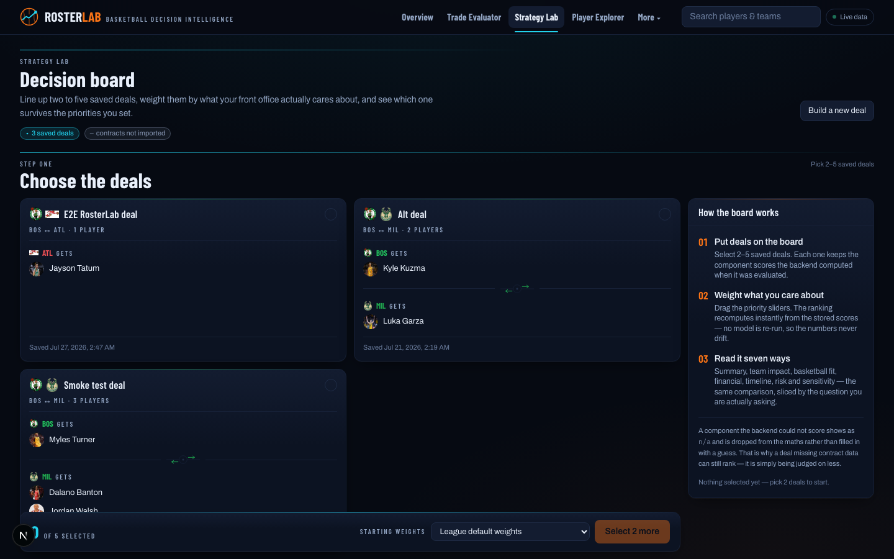
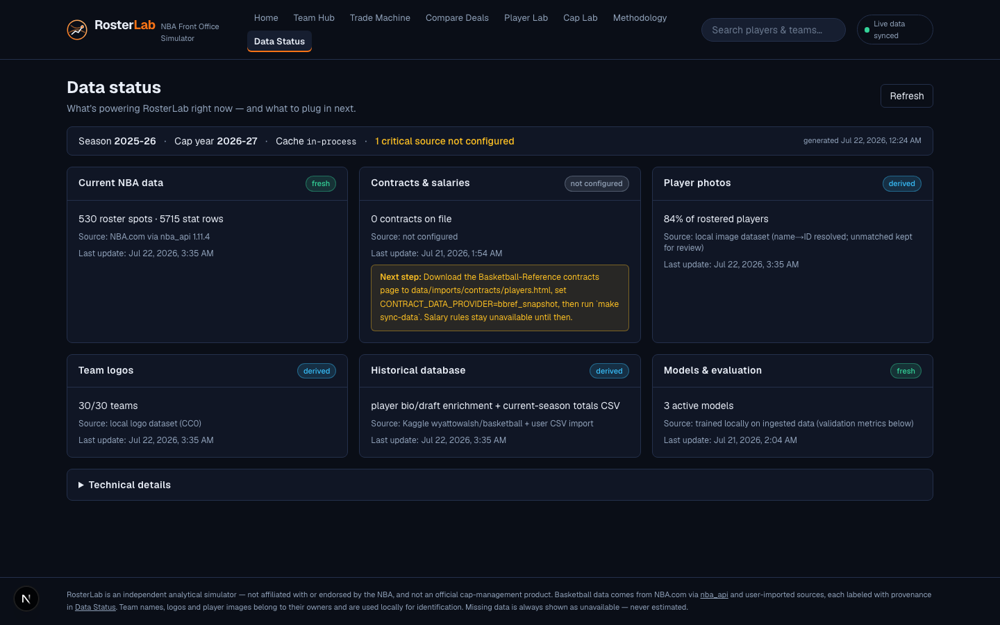
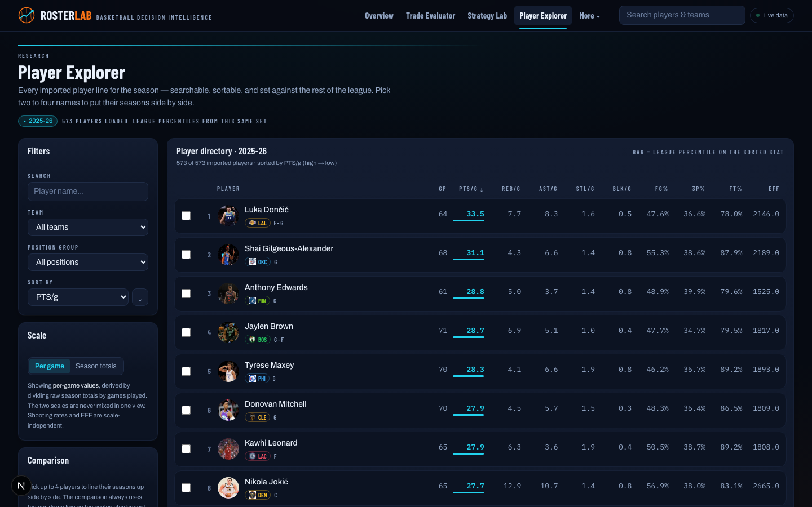
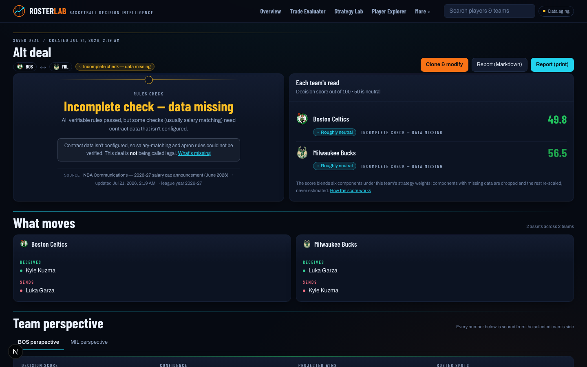

# Pivot — Basketball Intelligence for Better Decisions

**Understand a roster, find what it is missing, test a move, and read why — on live NBA data, with every number traced to how it was produced and what it cannot support.**

Pivot is a basketball decision-intelligence platform: real provider-backed NBA data, a CBA-aware rules engine with a four-state honesty standard, validated player-impact modeling, and a broadcast-grade product layer over serious, inspectable analytics.

The product philosophy is one loop:

```
OBSERVE  →  DIAGNOSE  →  COMPARE  →  SIMULATE  →  RECOMMEND  →  EXPLAIN
```



> **Status:** fully functional local build. Data below was ingested live from NBA.com (July 2026), enriched from a user CSV, the Kaggle basketball database, and local image datasets. **Not affiliated with the NBA.**
>
> Pivot was called **RosterLab** through its R1–R7 generation; those release reports are kept under their original names as the provenance record. A few infrastructure identifiers (the `tradelab-backend` distribution, the default `tradelab.db` filename, the `tradelab:` cache prefix, and the `TEI` acronym) deliberately keep their historical spelling — renaming them would move a database, invalidate a cache namespace, or change the meaning of a persisted column without changing anything a user sees. See [ADR-24](docs/decision-log.md).

---

## The decision workflow

| Step | Module | What it answers |
| --- | --- | --- |
| **1 · Understand the roster** | Teams | What does this team actually contain — rotation, roles, measured strengths, and the needs that follow? |
| **2 · Identify the edge** | Players | Who is out there, what do they do, and which of them answers a need this roster has? |
| **3 · Test the move** | Trade Evaluator | Two- and three-team deals with a live rules check, projected impact, fit, cost and risk |
| **4 · Make the decision** | Decision Board | The options side by side under your own priorities, with the trade-off frontier and rank stability |

## The modules

| Module | What it does | Status |
| --- | --- | --- |
| **Trade Evaluator** | The flagship. Two- and three-team deals across team workspaces joined by a transaction lane; drag-and-drop with accessible send controls, a live backend rules check, fan verdict then advanced analysis, save and share links | available |
| **Strategy Lab** | A decision board: visual deal cards, a component matrix, priority sliders that re-rank live, the trade-off frontier and rank stability | available |
| **Player Explorer** | 573 imported 2025-26 stat lines: photos, totals *and* derived per-game (never mixed), 2–4-player comparison, and league percentiles taken only over players whose sample can support one | available |
| **Team Outlook** | Broadcast-style team dashboard: roster by position group, model-derived strengths & needs, competitive window, payroll honesty, strategy setup | available |
| **Salary-Cap Center** | Payroll by season, top/expiring contracts, option markers, cap reference lines — activates when contracts are imported | needs contract import |
| **Precedent** | Ten seasons of completed trades, normalized locally. Ask what a proposal resembles and get back real transactions with a per-dimension similarity breakdown — and the statement that resemblance is not consequence | available |
| **Who fixes this?** | Start from a diagnosed need instead of a trade: filtered candidates, ranked by projected wins, each one already run through the trade evaluator with a balancing package | available |
| **Decision memo** | The whole analysis as one reviewable document — recommendation, rotation consequences, fit, cost, rules, precedent, risks, and one consolidated section naming what could not be established | available |
| **Contract Predictor** | Deliberately **on the roadmap**: needs historical contract data before a validated model can exist — Pivot ships no fake models | roadmap |

Routes were renamed to match these module names; every previous URL still redirects (share links keep their query strings).

## Data sources & hierarchy

Six sources, joined by **stable NBA IDs** with recorded confidence (see [docs/identity-resolution.md](docs/identity-resolution.md)); conflicts are logged, never silently overwritten:

1. **NBA.com via [`nba_api`](https://github.com/swar/nba_api)** (authoritative): teams, players, rosters, standings, stats, games — hardened client with rate limiting, retries, circuit breaker, schema contracts.
2. **User CSV** (`data/imports/nba_player_stats_2026.csv`): 2025-26 season **totals**, imported by official `PLAYER_ID` (573/582 matched; 9 unmatched recorded), per-game derived safely via GP.
3. **Kaggle [`wyattowalsh/basketball`](https://www.kaggle.com/datasets/wyattowalsh/basketball)** via `kagglehub`: historical bio/draft enrichment — fills only NULL fields (4,516 players enriched; 273 conflicts preserved un-overwritten).
4. **Basketball-Reference contracts snapshot** (user-downloaded page, parsed locally — no live scraping): salaries by league year with option markers; enables salary-matching rules and Cap Lab.
5. **Basketball-Reference season transaction pages** (`make fetch-transactions`, one request per season 3.5 s apart, honouring the source's published `Crawl-delay: 3`): **565 completed trades across 2016-17 … 2025-26**, 2,568 asset legs, 69 of them multi-team. 89.4 % of player legs resolve to a player here; the rest are filed as warnings and none is fuzzy-matched. Raw pages stay gitignored.
6. **`LeagueGameLog`, as a season calendar** (`make sync-season-calendar`): the first and last regular-season game of each of the ten seasons, so a completed trade is described by production that had actually been played when it was made. Ten rows. Without it the feature season falls back to the calendar month, which mis-describes draft-night, preseason and November-2020 trades — 57 of 565.
6. **Local image datasets** (gitignored): 30/30 team logos, 2,196/2,476 player-image folders resolved to identities by name→ID matching (280 unmatched kept for review); served by the backend with deterministic fallbacks.

**Data Status** shows six plain-language source cards (fresh / stale / derived / incomplete / unavailable) with coverage and the exact next step for anything missing.

## Honesty guarantees

- A trade is **never** labeled legal from partial validation: `passes / fails / incomplete (data missing) / not checked`.
- Missing salaries, injuries, or pick ownership are explicit unavailable states — never estimated.
- Season totals are never presented as per-game values; proxies are labeled as proxies.
- Every screen shows source + last-updated; every model shows its validation numbers.

## The analytics (validated, inspectable)

- **TEI (estimated player impact)**: a transparent weighted z-score index over recency-weighted 3-season features, time-aware validation against a persistence baseline (**0.645 vs 0.717 held-out MAE**); per-player uncertainty bands from σ² = 0.0326 + 240.9/minutes. A ridge challenger was retired in R3-1: it won on player-level MAE (0.637) and explained **R² = 0.004** of team net rating against the index's **0.751**. [Model card](docs/model-card-player-impact.md).
- **Wins projection**: 240-minute rotation reallocation with availability discounting; net-rating→wins slope **calibrated on 90 team-seasons (2.24, R²=0.95)**; 2,000-draw Monte Carlo per evaluation.
- **Decision score**: six weighted components (missing components excluded, weights renormalized) + Dirichlet rank-stability and tornado sensitivity.
- **CBA engine**: expanded/standard TPE bands (verified 2025-26 & 2026-27 figures), apron restrictions, aggregation prohibition, roster limits, recently-signed windows. [Rule-by-rule coverage](docs/cba-rule-coverage.md).
- **Comparable-trade retrieval**: an interpretable grouped distance over **1,151 rankable team-sides** from 535 completed trades (R7 widened the corpus window from three seasons to ten). Archetype precision@5 **0.917** against a 0.433 base rate, with a random ranker at 0.444 and a shuffled-feature corpus at 0.424; direction confusion **0.025** against a 0.05 ceiling; the whole battery re-runs with `make comparable-validation` in about 70 s.
- **Need-driven discovery**: filtered by the need, ranked by projected wins, then put through the trade evaluator under the candidate generator's own conditions — which takes the distinct players named across the league's top fives from **26 to 72**. `make acquisition-validation`.

Full write-up: [docs/methodology.md](docs/methodology.md) · in-product: `/methodology` (plain-language layer + technical layer).

## Screenshots

| Trade Evaluator | Team Outlook |
| --- | --- |
|  |  |

| Strategy Lab | Data Health |
| --- | --- |
|  |  |

| Player Explorer | Saved deal report |
| --- | --- |
|  |  |

## Getting started

> **Every command from `make migrate` onward writes to the database that `DATABASE_URL` names** — by default
> `backend/tradelab.db`, which on a long-lived checkout may be a hand-built, irreplaceable database. Know which
> database you are pointing at before you run anything past `make setup`, and prefer a **copy** for development.
> Read [Operating safely](#operating-safely-data-training-and-models) before running `make train` or `make score`.

```bash
make setup          # backend venv + frontend npm install + .env from template
make migrate        # Alembic (SQLite by default; Postgres via DATABASE_URL): changes that database's schema
make seed-config    # verified salary-cap parameters (2025-26 + 2026-27)
make sync-data      # live NBA data from NBA.com via nba_api (network): writes the ingested tables
make dev            # backend :8000 + frontend :3000
```

Training and scoring are deliberately not part of this sequence. On a **fresh, disposable database you just
created**, `make train && make score` is how the app obtains impact estimates and team needs. On any database that
already holds estimates you care about, they are destructive — see below.

### Optional data imports

Everything in this block also writes to the database `DATABASE_URL` names.

```bash
make index-assets      # player photos (./nbaplayerimages) + team logos (./nbalogos)
                       # Both folders are local and gitignored. Without them the app still works:
                       # teams show colour crests and players show initials/silhouettes. After adding
                       # or moving the folders, re-run this (or set ASSET_PLAYER_IMAGES_DIR / ASSET_LOGOS_DIR).
make import-stats-csv  # 2025-26 season totals (data/imports/nba_player_stats_2026.csv)
make import-kaggle     # Kaggle basketball DB enrichment (~700MB download; no auth for
                       # public datasets — see docs/kaggle-setup.md)
# Contracts: save basketball-reference.com/contracts/players.html to
# data/imports/contracts/players.html, set CONTRACT_DATA_PROVIDER=bbref_snapshot,
# then: make sync-data   (see data/imports/README.md)

make sync-corpus-stats                       # ten seasons of player stats, standings, calendars
make fetch-transactions FROM=2017 TO=2026   # completed trades, one page per season
make import-transactions                     # parse them into historical_trades
make transaction-coverage                    # what the corpus holds
```

`sync-corpus-stats` widens what the **comparable-trade corpus** can be described by. It
does not widen the modelling window: every served estimate stays fitted on
`HISTORY_SEASONS`, and `tests/unit/test_corpus_window_isolation.py` keeps the two apart.

Containerized: `docker compose up --build` (Postgres 16 + Redis 7 + API + worker + frontend).

### Testing

```bash
make test                     # backend pytest (897, coverage floor 85 %) + frontend vitest (82)
make lint                     # ruff + mypy + eslint + tsc
make e2e                      # Playwright core flows against the local stack (5 specs)
make comparable-validation    # comparable-trade battery; exits non-zero on a threshold
make acquisition-validation   # need-driven discovery battery, over all 30 rosters
make lineup-availability      # re-measure whether lineup data could support a fit model
```

Visual QA is scripted too — `node scripts/visual_qa.mjs docs/qa/run` screenshots every
route at 1920/1440/1366/1280/1024/768/390 — 15 routes, 105 shots — and fails loudly on
horizontal overflow, console errors or an empty body. Its output is gitignored; the curated shots above live in
`docs/screenshots/`.

## Operating safely: data, training and models

Ingestion, training and scoring are **operations on a database**, not setup steps. Verified against
`Makefile`, `backend/app/cli.py` and `backend/app/analytics/` — the runbooks linked below hold the full detail.

| Command | What it does to the database `DATABASE_URL` names |
| --- | --- |
| `make migrate`, `make seed-config` | Alter the schema / load cap parameters. Rehearse migrations on a copy first. |
| `make sync-data` (`sync-all`) | Network. Upserts teams, players, rosters, standings, team and player statistics, games, the season calendar and contracts, then writes data-quality issue rows. A full roster refresh can rewrite stored bio fields — see the [R8.2 runbook](docs/r8-2/operational-runbook.md) §1. Seasons come from settings, not from an argument. |
| `make refresh`, `sync-corpus-stats`, `import-*`, `link-balldontlie`, `refresh-balldontlie` | Write ingested or imported rows; several also reach a third party. |
| **`make train`** (legacy) | Retires the active version of up to five model families (impact, archetype, TEI→net-rating, team projection, pick curve) and activates the new ones **in the same transaction**, with no evaluation step. Writes impact estimates and archetypes labelled with `Settings.current_season`. **Unless `ARGS=--preserve-history`, it permanently deletes every impact estimate of an inactive version** — re-activating an old version does not bring them back; only a backup does. |
| **`make score`** | Writes, updates and **deletes** `team_needs` rows for `Settings.current_season`. |
| `make train-candidate`, `make materialise-skills` | Write *candidate* models and estimates that no serving path reads, and prove that nothing else changed. Still write — run them on a copy. |
| `make backtest` | Read-only on the database; writes artifacts under `models/experiments/`. Its `holdout` stage spends the holdout (below). |
| `make activate-provider-data` | Dry run unless `APPLY=1`; an apply writes into `DATABASE_URL` after taking a backup. |
| `make purge-fixtures` | Lists test leftovers; deletes only with `APPLY=1`. |
| `make seed-demo`, `make e2e` | **Delete and recreate** `E2E_DB` (default `backend/rosterlab-e2e.db`), then train and score it. Never point `E2E_DB` at a real database. |
| `make data-status`, `make season-status`, `make candidates`, `make contract-coverage` | Read-only. Use these first. |

**Rules**

- **Never train or score against the owner's real database** without a separately approved operational procedure
  that includes a verified backup. Rehearse on a copy (`cp backend/tradelab.db <copy>`, then
  `DATABASE_URL=sqlite:///<copy> make …`).
- **Candidate training and activation are different operations.** `make train-candidate` never changes an active
  model. Nothing in the repository promotes a candidate: promotion is designed but not built — see
  [model versioning and safety](docs/r9-1/model-versioning-and-safety.md) and
  [model safety and promotion](docs/r9-2/model-safety-and-promotion.md).
- **Holdout evaluation follows the preregistered protocol.** Run `make backtest BT_STAGE=development` first; the
  `holdout` stage needs exactly one development run per target, records every read in `holdout_ledger.json`, and a
  re-read needs an explicit `--acknowledge-reread`. Never tune on the holdout.
  See [evaluation architecture](docs/r9-1/evaluation-architecture.md) and
  [`preregistration.json`](docs/r9-1/preregistration.json).
- **Verify the season settings before training or evaluating.** `make train` and `make score` use
  `Settings.current_season` — the pinned `CURRENT_SEASON` if set, otherwise the calendar's analysis season — and
  `make train` derives its three-season window from it. Run `make season-status` and read `pinned_behind_calendar`
  and the `seasons` block. **2026-11-03 is the documented statistics rollover checkpoint** (see
  [season-context architecture](docs/r8-2/season-context-architecture.md)); confirm the configuration actually in
  force rather than assuming it is right, and do not train or score across it without the
  [R8.2 operational runbook](docs/r8-2/operational-runbook.md) §5.

## Repository policy

No NBA data, images, or licensed datasets are committed — everything is fetched or imported locally by the operator with provenance. Test fixtures are tiny, clearly-marked synthetic records. See [data/README.md](data/README.md).

## Documentation

[Pivot audit](docs/pivot/audit.md) · [Target architecture](docs/pivot/target-architecture.md) · [Gap analysis](docs/pivot/gap-analysis.md) · [R8 readiness](docs/pivot/r8-readiness.md) · [Architecture](docs/architecture.md) · [Methodology](docs/methodology.md) · [CBA coverage](docs/cba-rule-coverage.md) · [Data sources](docs/data-sources.md) · [Data dictionary](docs/data-dictionary.md) · [Identity resolution](docs/identity-resolution.md) · [Kaggle setup](docs/kaggle-setup.md) · [Decision log](docs/decision-log.md) · [Model cards](docs/model-card-player-impact.md) · [Limitations](docs/limitations.md) · [Demo script](docs/demo-script.md) · [Interview guide](docs/interview-guide.md) · [Enhancement plan (historical)](docs/rosterlab-enhancement-plan.md)

## Roadmap

The next phase is the **GM Intelligence** progression, mapped release by release in
[docs/pivot/gap-analysis.md](docs/pivot/gap-analysis.md):

| | | Status |
| --- | --- | --- |
| **R8** | Canonical basketball data foundation | [next — concrete plan](docs/pivot/r8-readiness.md) |
| **R9** | Player intelligence engine | 9 of 22 declared dimensions measured; the rest need tracking or matchup data |
| **R10** | Archetype engine | 14 functional archetypes ship; multi-membership needs a schema change |
| **R11** | Roster intelligence / needs | profile and needs ship; scarcity and complementarity do not |
| **R12** | Team-conditional fit | addressable and measured; must survive a sparse need vector |
| **R13** | Scenario engine | `RosterState` / `Move` / `apply` exist; no engine consumes them yet |
| **R14** | GM Copilot | 4 of 10 tools implemented, 6 declared with reasons |

Earlier ideas — Salary Predictor (once historical contract data exists), Free Agency Planner,
Draft Fit, Rotation Builder, Extension Simulator — remain honest "not built" states in the
product, never fake functionality.

## Disclaimer

Independent portfolio project; not affiliated with or endorsed by the NBA or NBPA. NBA data is retrieved at runtime under the source sites' terms and is not redistributed. Team names/logos and player images belong to their owners and are used locally for identification. This is an analytical simulator, not professional cap-management or investment advice.
